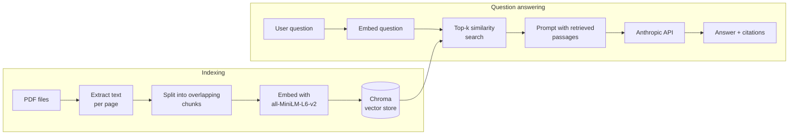

# 🎓 University Policy Q&A Assistant (RAG)

A retrieval-augmented generation (RAG) app that answers questions about university policy documents. Upload public PDFs, ask a question in plain English, and get an answer **grounded in the documents** with **file and page citations**. If the answer isn't in the documents, the assistant says so instead of guessing.


> **Disclaimer:** This is a portfolio project that works from documents you provide. It is not official advice. Always confirm policies with your university.

---

## ✨ Features

- **Cited answers:** every answer references the source file and page
- **Grounded generation:** the model is instructed to use only the retrieved passages and to say when it can't find an answer
- **Upload and index from the UI:** add PDFs in the sidebar and rebuild the index in one click
- **Transparent retrieval:** view the retrieved passages and their similarity distances under each answer
- **Adjustable top-k:** change how many passages are retrieved
- **Evaluation harness:** measures retrieval hit rate across chunk sizes and top-k values
- **Tested and containerized:** unit tests, GitHub Actions CI, and a Dockerfile

---

## 🏗️ Architecture



**Design decisions**

| Decision | Reason |
|---|---|
| Local sentence-transformers embeddings | Free, no extra API key, fast on a laptop |
| Chroma with cosine distance | Simple, persists to disk, easy to explain |
| Page-level metadata on every chunk | Enables precise citations |
| Overlapping chunks | Avoids cutting an answer in half at a chunk boundary |
| Strict "answer only from context" prompt | Reduces hallucination and supports "I don't know" |

---

## 🛠️ Tech Stack

| Layer | Technology |
|---|---|
| UI | Streamlit |
| PDF parsing | pypdf |
| Embeddings | sentence-transformers (`all-MiniLM-L6-v2`) |
| Vector store | ChromaDB |
| LLM | Anthropic API |
| Testing / CI | pytest, GitHub Actions |
| Packaging | Docker |

---

## 📁 Project Structure

```
rag-document-assistant/
├── app.py                  # Streamlit app
├── src/
│   ├── config.py           # Settings (paths, chunk size, model names)
│   ├── embeddings.py       # Embedding model wrapper
│   ├── ingest.py           # PDF loading, chunking, indexing
│   ├── retriever.py        # Similarity search
│   ├── generator.py        # Prompt building and LLM call
│   └── search_test.py      # Retrieval check without the LLM
├── evaluation/
│   ├── questions.json      # Your test questions (edit this)
│   └── run_eval.py         # Hit-rate evaluation
├── tests/                  # Unit tests
├── data/                   # Put your PDFs here
├── .github/workflows/      # CI
├── Dockerfile
├── requirements.txt
├── .env.example
└── README.md
```

---

## 🚀 Getting Started

### Prerequisites
- Python 3.10+
- An [Anthropic API key](https://console.anthropic.com/)

### 1. Clone and install

```bash
git clone https://github.com/madhurisandhi/rag-document-assistant.git
cd rag-document-assistant

python -m venv venv
source venv/bin/activate          # Windows: venv\Scripts\activate
pip install -r requirements.txt
```

### 2. Add your API key

```bash
cp .env.example .env              # then edit .env and add ANTHROPIC_API_KEY
```

### 3. Add documents and build the index

Put **publicly available** PDFs in `data/` (text-based, not scanned images), then:

```bash
python -m src.ingest
python -m src.search_test "How do I appeal a grade?"    # optional retrieval check
```

The first run downloads the embedding model, so it takes a minute.

### 4. Run the app

```bash
streamlit run app.py
```

Open `http://localhost:8501`. You can also upload PDFs and re-index from the sidebar.

### Run with Docker

```bash
docker build -t rag-assistant .
docker run -p 8501:8501 --env-file .env rag-assistant
```

---

## 📊 Evaluation

Retrieval quality is measured with a small question set that you write for your own documents.

1. Edit `evaluation/questions.json` with 20-30 questions. For each, list the `expected_keywords` that must appear in the passage that answers it.
2. Run:

```bash
python -m evaluation.run_eval
```

A retrieval counts as a **hit** if at least one of the top-k chunks contains all of the expected keywords. The script compares chunk sizes (200, 350, 500 words) and top-k values (1, 3, 5), and saves a table to `evaluation/results.md`.

### Results

> Run the evaluation on your documents and paste the table here, along with the number of questions used.

| Chunk size (words) | Hit@1 | Hit@3 | Hit@5 |
|---|---|---|---|
| 200 | | | |
| 350 | | | |
| 500 | | | |

**Takeaways:** _Add 2-3 sentences on what you found, such as which chunk size worked best and where retrieval failed._

---

## ⚠️ Limitations

- Works only with text-based PDFs; scanned documents need OCR
- Each question is answered independently (no conversation memory yet)
- Quality depends on the documents provided and on chunking choices
- Uploaded files are stored in `data/` on the machine running the app, so a public deployment would share them between users
- The keyword-based evaluation measures retrieval, not answer correctness

---

## 🗺️ Roadmap

- [ ] Conversation memory for follow-up questions
- [ ] Hybrid search (keyword + vector) and re-ranking
- [ ] Answer-quality evaluation (faithfulness and correctness)
- [ ] Streaming responses
- [ ] Live demo deployment

---

## 📝 License

MIT. See [LICENSE](LICENSE).

## 👩‍💻 Author

**Madhuri Sandhi**  
MPS Analytics, Northeastern University (Vancouver)  
[GitHub](https://github.com/madhurisandhi)
